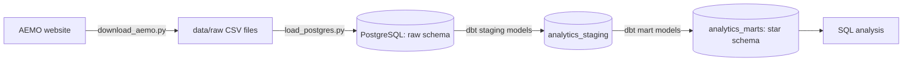

# NEM Energy Pipeline

An end-to-end data pipeline for Australia's National Electricity Market (NEM). It collects AEMO's 5-minute wholesale price and demand data, stores it in a database, and models it into a tested star schema with dbt. Built in stages, from a local prototype to a cloud pipeline on Azure.

**Status:** local pipeline complete (ingestion, PostgreSQL, dbt star schema with 25 data tests). Cloud build in progress.

## Why this data
The NEM sets a wholesale electricity price every 5 minutes for each region. Prices swing from negative (when rooftop solar floods the grid) to the market price cap within the same day, which makes the data a good test of a pipeline's ability to handle volume, time zones and extreme values.

## Data source
AEMO aggregated price and demand data: 5-minute regional reference price (RRP, $/MWh) and total grid demand (MW) for NSW, QLD, VIC, SA and TAS.

Current dataset: October 2026, 44,640 rows (8,928 intervals for each of the five regions, with no gaps).

All timestamps are in NEM market time (AEST, UTC+10, with no daylight saving).

## Architecture (current)


## Data model
Built with dbt in two layers.

**Staging** (views in `analytics_staging`): cleaned copies of the raw tables with clear column names and correct data types.
- `stg_price_demand`: one row per region per 5-minute interval, with interval start and end times, the interval's date, price, demand and a negative-price flag.
- `stg_region`: one row per region with its full state name.

**Marts** (tables in `analytics_marts`): a star schema for analysis.

| Table | Type | Grain | Rows |
|---|---|---|---|
| `fact_dispatch_price` | Fact | One row per region per 5-minute interval | 44,640 |
| `dim_region` | Dimension | One row per NEM region | 5 |
| `dim_date` | Dimension | One row per day | 31 |
| `dim_interval` | Dimension | One row per 5-minute slot in a day, grouped into periods (overnight, morning, solar hours, evening peak, late evening) | 288 |


### Data tests
25 dbt tests run on every build, including:
- No missing prices, demand values, regions or timestamps
- Region codes limited to the five NEM regions
- Every fact row links to a valid region, date and time slot (relationship tests)
- Exactly one row per region per interval
- No price below the NEM market floor of -$1,000/MWh
- The fact table keeps every row from staging (no rows lost in joins)

## Tech stack
- **Python:** pandas, requests, SQLAlchemy, matplotlib
- **Database:** PostgreSQL 18
- **Transformation:** dbt Core 1.9 with the PostgreSQL adapter
- **Tooling:** Git, GitHub, VS Code

## Data engineering practices
- **Idempotent ingestion:** the download script skips files that already exist, so it can be re-run safely.
- **Layered design:** raw data lands untouched, then is cleaned in staging and modelled in marts.
- **Automated data quality:** dbt tests check every build for missing values, duplicates, broken relationships and out-of-range prices.
- **Correct time handling:** each interval is assigned to the day it starts in, so the interval ending at midnight belongs to the previous day.
- **Re-runnable SQL:** table creation uses `IF NOT EXISTS` and inserts use `ON CONFLICT DO NOTHING`.
- **Secrets kept out of code:** database credentials live in a local `.env` file and dbt's `profiles.yml`, both outside version control.

## Project structure
```
nem-energy-pipeline/
├── src/
│   ├── download_aemo.py      # downloads a month of AEMO data for all five regions
│   └── load_postgres.py      # loads raw CSVs into PostgreSQL (raw.price_demand)
├── nem_dbt/                  # dbt project
│   ├── models/
│   │   ├── staging/          # sources, staging models and their tests
│   │   └── marts/            # star schema: fact and dimension tables
│   ├── tests/                # custom SQL data tests
│   └── dbt_project.yml
├── notebooks/
│   └── 01_explore_aemo.py    # exploration and price-by-hour chart
├── sql/
│   └── 01_analysis.sql       # early analysis queries and the region lookup table
├── docs/                     # charts and the dbt lineage diagram
├── .env.example
├── requirements.txt
└── README.md
```

## How to run
1. Set up the environment:
   ```
   python -m venv .venv
   .venv\Scripts\activate
   pip install -r requirements.txt
   ```
2. Copy `.env.example` to `.env` and fill in your PostgreSQL details. Create a database called `nem`.
3. Download and load the data:
   ```
   python src/download_aemo.py
   python src/load_postgres.py
   ```
4. Create the region lookup table by running query 5 in `sql/01_analysis.sql`.
5. Build and test the dbt models:
   ```
   cd nem_dbt
   dbt debug
   dbt build
   ```
   On first use, run `dbt init` or create `profiles.yml` in your user folder with your PostgreSQL connection.
6. Browse the documentation and lineage:
   ```
   dbt docs generate
   dbt docs serve
   ```

## Findings (October 2026)


| Region | Average price ($/MWh) | Average demand (MW) | Share of intervals with negative prices |
|---|---|---|---|
| New South Wales | 127.83 | 6,666 | 0.6% |
| Queensland | 94.09 | 5,954 | 7.4% |
| Tasmania | 61.59 | 978 | 18.7% |
| Victoria | 52.94 | 4,885 | 27.0% |
| South Australia | 49.70 | 1,057 | 32.9% |

- **NSW's high average came from two short price events.** A single interval hit $23,200/MWh at 7:20am on 10 October, and prices ran between about $10,000 and $23,100/MWh for nearly an hour from 2:20pm on 12 October. Most of the month was far cheaper, which shows how much a few extreme intervals can move an average.
- **South Australia had negative prices in 32.9% of October's 5-minute intervals,** about 244 hours in total, followed by Victoria at 27.0%. NSW was negative in only 0.6%.
- **Prices go negative in the middle of the day in SA and VIC** and rise sharply from about 5pm as solar output falls and household demand climbs.
- **NSW grid demand peaks at 6pm (8,290 MW) and is lowest at midday (4,943 MW),** below its overnight level of about 6,400 MW at 3am, because rooftop solar covers much of the daytime use.

## Roadmap
- [x] Download raw AEMO data with Python
- [x] Load into PostgreSQL and analyse with SQL
- [x] Model with dbt: staging models, star schema and data tests
- [ ] Move to Azure: Data Lake Storage and Databricks (bronze, silver and gold layers)
- [ ] Orchestrate with Azure Data Factory
- [ ] CI with GitHub Actions
- [ ] Power BI report