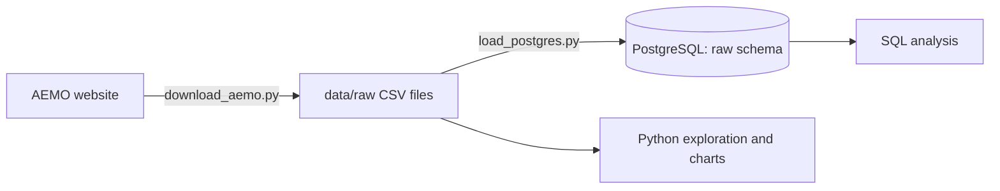

# NEM Energy Pipeline

An end-to-end data pipeline for Australia's National Electricity Market (NEM). It collects AEMO's 5-minute wholesale price and demand data, stores it in a database, and models it for analysis. Built in stages, from a local prototype to a cloud pipeline on Azure.

**Status:** local prototype complete (ingestion, storage, exploration and SQL analysis). Cloud build in progress.

## Why this data
The NEM sets a wholesale electricity price every 5 minutes for each region. Prices swing from negative (when rooftop solar floods the grid) to the market price cap within the same day, which makes the data a good test of a pipeline's ability to handle volume, time zones and extreme values.

## Data source
AEMO aggregated price and demand data: 5-minute regional reference price (RRP, $/MWh) and total grid demand (MW) for NSW, QLD, VIC, SA and TAS.

Current dataset: October 2026, 44,640 rows (8,928 intervals for each of the five regions, with no gaps).

All timestamps are in NEM market time (AEST, UTC+10, with no daylight saving).

## Architecture (current)


## Tech stack
- **Python:** pandas, requests, SQLAlchemy, matplotlib
- **Database:** PostgreSQL 18
- **SQL:** aggregations, window-ready queries, joins to a dimension table
- **Tooling:** Git, GitHub, VS Code

## Data engineering practices
- **Idempotent ingestion:** the download script skips files that already exist, so it can be re-run safely.
- **Raw layer kept separate:** source data lands untouched in a `raw` schema, ready to be cleaned and modelled in later layers.
- **Re-runnable SQL:** table creation uses `IF NOT EXISTS` and inserts use `ON CONFLICT DO NOTHING`.
- **Secrets kept out of code:** database credentials are read from a local `.env` file that is excluded from Git.

## Project structure
```
nem-energy-pipeline/
├── src/
│   ├── download_aemo.py      # downloads a month of AEMO data for all five regions
│   └── load_postgres.py      # loads raw CSVs into PostgreSQL (raw.price_demand)
├── notebooks/
│   └── 01_explore_aemo.py    # exploration and price-by-hour chart
├── sql/
│   └── 01_analysis.sql       # analysis queries and the region dimension table
├── docs/
│   └── price_by_hour.png
├── .env.example              # template for database settings
├── requirements.txt
└── README.md
```

## How to run
1. Set up the environment:
   ```
   python -m venv .venv
   .venv\Scripts\activate
   pip install -r requirements.txt
   ```
2. Copy `.env.example` to `.env` and fill in your PostgreSQL details.
3. Create a PostgreSQL database called `nem`.
4. Download a month of data: `python src/download_aemo.py`
5. Load it into PostgreSQL: `python src/load_postgres.py`
6. Explore: `python notebooks/01_explore_aemo.py`
7. Run the analysis queries in `sql/01_analysis.sql`.

## Findings (October 2026)


| Region | Average price ($/MWh) | Average demand (MW) | Share of intervals with negative prices |
|---|---|---|---|
| New South Wales | 127.83 | 6,666 | 0.6% |
| Queensland | 94.09 | 5,954 | 7.4% |
| Tasmania | 61.59 | 978 | 18.7% |
| Victoria | 52.94 | 4,885 | 27.0% |
| South Australia | 49.70 | 1,057 | 32.9% |

- **NSW's high average came from two short price events.** A single interval hit $23,200/MWh at 7:20am on 10 October, and prices ran between about $10,000 and $23,100/MWh for nearly an hour from 2:20pm on 12 October. Most of the month was far cheaper, which shows how much a few extreme intervals can move an average.
- **South Australia had negative prices in 32.9% of October's 5-minute intervals,** about 244 hours in total, followed by Victoria at 27.0%. NSW was negative in only 0.6%.
- **Prices go negative in the middle of the day in SA and VIC** and rise sharply from about 5pm as solar output falls and household demand climbs.
- **NSW grid demand peaks at 6pm (8,290 MW) and is lowest at midday (4,943 MW),** below its overnight level of about 6,400 MW at 3am, because rooftop solar covers much of the daytime use.

## Roadmap
- [x] Download raw AEMO data with Python
- [x] Load into PostgreSQL and analyse with SQL
- [ ] Model with dbt (staging models and a star schema with tests)
- [ ] Move to Azure: Data Lake Storage and Databricks (bronze, silver and gold layers)
- [ ] Orchestrate with Azure Data Factory
- [ ] CI with GitHub Actions
- [ ] Power BI report