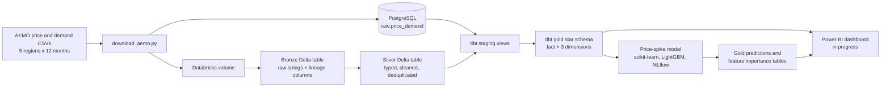
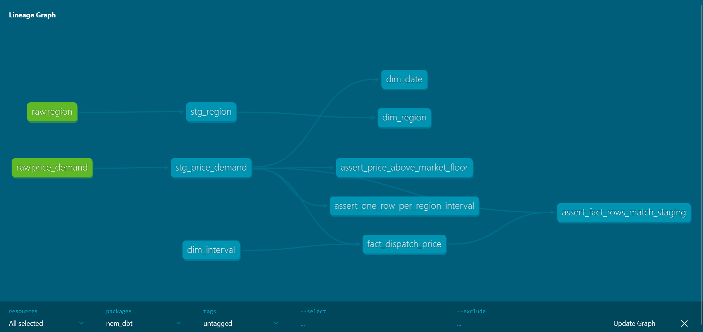
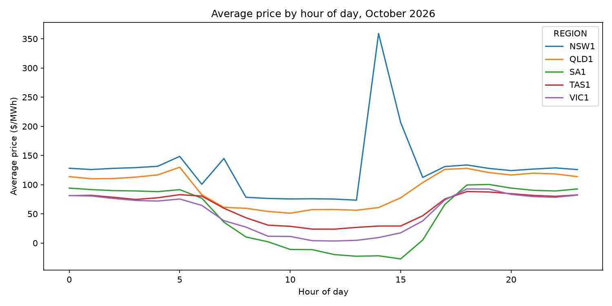

# NEM Electricity Market Pipeline

An end-to-end data pipeline for Australia's National Electricity Market (NEM). It takes a year of AEMO's 5-minute wholesale price and demand data, builds bronze, silver and gold layers in Databricks, models a tested star schema with dbt, and trains a price-spike model tracked in MLflow.

The same dbt project runs on two platforms: PostgreSQL on my laptop and Databricks in the cloud. Both pass the same 25 data tests on the same 525,600 rows.

**Status:** pipeline, star schema and price-spike model done. Power BI dashboard, Azure ingestion, scheduling and CI in progress (see [Roadmap](#roadmap)).

---

## Architecture



---

## Data

| | |
|---|---|
| Source | [AEMO aggregated price and demand data](https://aemo.com.au/energy-systems/electricity/national-electricity-market-nem/data-nem/aggregated-data) |
| Regions | NSW1, QLD1, VIC1, SA1, TAS1 |
| Period | November 2025 to October 2026 (12 months) |
| Grain | One row per region per 5-minute dispatch interval |
| Volume | 60 files, 525,600 rows (365 days x 288 intervals x 5 regions) |
| Columns | Settlement date, region, price ($/MWh), total demand (MW) |

All times are NEM market time (AEST, no daylight saving). An interval is dated by its start, so the interval ending at midnight belongs to the previous day.

---

## Medallion layers (Databricks, Unity Catalog)

| Layer | Table | What happens |
|---|---|---|
| Bronze | `workspace.bronze.price_demand` | Raw CSVs loaded as strings, plus `_source_file` and `_ingested_at` for lineage |
| Silver | `workspace.silver.price_demand` | Timestamps parsed, prices and demand cast to decimal, interval start and date derived, nulls removed, duplicates dropped |
| Gold | `workspace.gold.*` | dbt star schema, model predictions and feature importance |

All tables are Delta, so every load is versioned (`DESCRIBE HISTORY`) and can be queried at an earlier version with time travel.

---

## Data model (gold)

| Table | Grain | Key columns |
|---|---|---|
| `fact_dispatch_price` | Region x 5-minute interval | region_code, date_day, interval_of_day, price_aud_per_mwh, demand_mw, is_negative_price |
| `dim_region` | One row per region | region_code, state_name |
| `dim_date` | One row per day | date_day, year, month, month_name, day_name, day_of_week, is_weekend |
| `dim_interval` | One row per 5-minute slot (288) | interval_of_day, hour_of_day, interval_start_time, day_period |



### Tests

`dbt build` runs 6 models, 1 seed and 25 data tests, and all pass on both PostgreSQL and Databricks:

- Not null, unique and accepted values on keys and measures
- Relationships from the fact to every dimension
- One row per region per interval
- No price below the market floor of -$1,000/MWh
- Fact row count matches staging, so no rows are lost or duplicated in the joins

---

## Price-spike model

**Question:** will a region's price go above $300/MWh in the next 30 minutes? Batteries, retailers and large energy users act on exactly this.

**Set-up**
- Label: price above $300/MWh. That's 2,271 of 525,600 intervals (0.43%), so the classes are heavily imbalanced.
- Features use only information available 30 minutes before the interval: the price 30 minutes earlier, the highest price in the previous hour and the previous 24 hours, the highest price anywhere in the NEM, recent demand and how fast it's rising, hour, day of week and region.
- Time-based split: trained on November 2025 to July 2026, tested on August to October 2026 (200 spikes). July was held out inside the training period for early stopping and for choosing the warning cut-off, so the test months were never used for tuning.
- 10 classifiers compared against a simple persistence rule: "spike if the price 30 minutes ago was above $300". Every run is tracked in MLflow.

**Results on the test months**

| Model | PR AUC | ROC AUC |
|---|---|---|
| Persistence rule (price 30 minutes ago) | **0.294** | 0.941 |
| LightGBM, tuned with early stopping | 0.226 | **0.956** |
| Logistic regression | 0.176 | 0.921 |
| Random forest | 0.175 | 0.939 |
| Gradient boosting, tuned | 0.138 | 0.955 |
| Logistic regression + SMOTE | 0.135 | 0.913 |
| Extra trees | 0.080 | 0.850 |
| Gradient boosting | 0.067 | 0.936 |
| LightGBM | 0.062 | 0.938 |
| XGBoost | 0.033 | 0.886 |
| Always predict "no spike" | 0.0015 | 0.500 |

PR AUC is the main metric because spikes are rare. A model that never predicts a spike is right 99.6% of the time and useless.

**What I found**
- **The first version barely beat chance.** With only calendar and demand features, the best PR AUC was 0.0025 and ROC AUC was about 0.6. The models knew when prices are usually high, but not whether the market was under stress right now. Adding recent-price features lifted PR AUC about 90 times.
- **The persistence rule still wins at 30 minutes ahead.** At the cut-off chosen on July, the best model raised 39 warnings with 49% precision but caught only 10% of spikes. The rule caught 46% with about the same precision. LightGBM ranks intervals better overall (highest ROC AUC), but the rule is better at finding the most likely spikes.
- **The gap comes from seasonal shift.** The model scored 0.90 precision and 0.82 recall on July but much lower on spring. About 1,167 spikes fell in May to July and only 200 in August to October, so it learnt patterns from a much busier period than the one it was tested on.
- **Most useful features:** the highest price in the previous 24 hours ("has today been a stressed day?"), the price 30 minutes earlier, and the highest price anywhere in the NEM.

**Next steps for the model:** add AEMO's pre-dispatch price and demand forecasts as features, and train on several years so the model sees more than one of each season.

Predictions for every interval (model warning, rule warning, spike probability) are saved to `workspace.gold.price_spike_predictions` (525,510 rows: the first 18 intervals of each region have no history). Feature importance is saved to `workspace.gold.spike_feature_importance`.

---

## Findings (November 2025 to October 2026)

| Region | Avg price ($/MWh) | Max price | Min price | Negative-price intervals | Spikes above $300 | Avg demand (MW) |
|---|---|---|---|---|---|---|
| NSW1 | 78.79 | 23,200.00 | -999.99 | 7.5% | 324 | 7,439 |
| QLD1 | 66.03 | 19,727.85 | -245.64 | 11.8% | 119 | 6,186 |
| SA1 | 69.83 | 20,300.00 | -906.68 | 28.5% | 1,455 | 1,298 |
| TAS1 | 72.47 | 23,200.00 | -1,000.00 | 5.3% | 161 | 1,016 |
| VIC1 | 48.04 | 19,069.69 | -969.97 | 24.7% | 212 | 5,049 |

- **South Australia is the most volatile region.** It has 64% of all spikes and the most negative prices (28.5% of intervals), despite having the second-lowest demand. A small grid with a lot of wind and solar swings both ways.
- **Victoria is the cheapest region on average** ($48.04/MWh), with negative prices in about a quarter of intervals.
- **Prices hit the market price cap and floor.** NSW and Tasmania both reached $23,200/MWh, and Tasmania hit the -$1,000/MWh floor.
- **Spikes are seasonal.** June and July were the busiest months, with more than 550 spikes each, driven by winter evening peaks. January was next with 500, from summer heat. August to October had only 200 between them.
- **Negative prices peak in spring and early summer** (30.7% of intervals in November 2025), when rooftop solar is strong and demand is mild.



---

## Tech stack

| Area | Tools |
|---|---|
| Ingestion | Python, requests |
| Storage | PostgreSQL, Databricks volumes, Delta Lake |
| Processing | pandas, PySpark |
| Transformation and testing | dbt Core (dbt-postgres, dbt-databricks), SQL |
| Governance | Unity Catalog |
| Machine learning | scikit-learn, XGBoost, LightGBM, imbalanced-learn, MLflow |
| Version control | Git, GitHub, Databricks Git folders |

---

## Engineering practices

- **Idempotent loads.** The download skips files it already has. The Postgres load truncates and reloads, and SQL uses `IF NOT EXISTS` and `ON CONFLICT`, so rerunning never duplicates data.
- **One dbt project, two warehouses.** Jinja `target.type` switches between Postgres and Spark SQL where the syntax differs. A custom `generate_schema_name` macro writes to silver and gold on Databricks and to `analytics_*` schemas on Postgres.
- **Tested before it's trusted.** 25 dbt tests, including reconciliation of row counts between layers.
- **Honest model evaluation.** Time-based split, a held-out tuning month, features limited to what was known 30 minutes earlier, and a simple baseline every model has to beat.
- **Secrets stay out of Git.** Credentials live in `.env` and `~/.dbt/profiles.yml`. Raw data stays out of Git too: code goes in the repo, data doesn't.

---

## Repository structure

```
nem-energy-pipeline/
├── src/
│   ├── download_aemo.py         # downloads monthly AEMO CSVs for 5 regions
│   └── load_postgres.py         # loads all CSVs into raw.price_demand
├── notebooks/
│   └── 01_explore_aemo.py       # pandas exploration and quality checks
├── sql/
│   └── 01_analysis.sql          # analysis queries on the raw table
├── databricks/
│   ├── 01_explore_aemo_spark    # PySpark exploration
│   ├── 02_bronze_silver         # bronze and silver Delta tables
│   └── 03_price_spike_model     # features, 10 models, MLflow, predictions
├── nem_dbt/
│   ├── models/staging/          # sources, staging views, tests
│   ├── models/marts/            # star schema, tests
│   ├── seeds/region.csv
│   ├── tests/                   # singular tests
│   └── macros/                  # generate_schema_name
├── docs/                        # charts and lineage diagram
├── .env.example
└── README.md
```

---

## How to run

### Local (PostgreSQL)

```powershell
python -m venv .venv
.venv\Scripts\activate
pip install pandas requests sqlalchemy psycopg2-binary python-dotenv matplotlib "dbt-core==1.9.*" "dbt-postgres==1.9.*" "dbt-databricks==1.9.*"

# copy .env.example to .env and fill in your Postgres details
python src/download_aemo.py
python src/load_postgres.py

cd nem_dbt
dbt build
```

### Databricks

1. Upload the CSVs from `data/raw` to the volume `/Volumes/workspace/default/aemo_raw/`.
2. Run `databricks/02_bronze_silver` to build the bronze and silver tables.
3. Add a `databricks` target to `~/.dbt/profiles.yml` (host, HTTP path of a SQL warehouse, and a personal access token), then run `dbt build --target databricks` from the `nem_dbt` folder.
4. Run `databricks/03_price_spike_model` on serverless notebook compute.

---

## Roadmap

- [x] Download 12 months of AEMO data for all 5 regions
- [x] Load into PostgreSQL and explore with SQL and pandas
- [x] dbt star schema with 25 tests on PostgreSQL
- [x] Bronze and silver Delta tables in Databricks
- [x] Same dbt project running on Databricks (gold layer)
- [x] Price-spike model with MLflow tracking, benchmarked against a persistence rule
- [ ] Power BI dashboard: market overview, price events, AI insights
- [ ] Azure Data Lake Storage and Data Factory for scheduled ingestion
- [ ] Databricks Jobs to run silver, dbt and the model on a schedule
- [ ] GitHub Actions: dbt build and SQLFluff on every pull request
- [ ] Design decisions write-up (`docs/DESIGN_DECISIONS.md`)